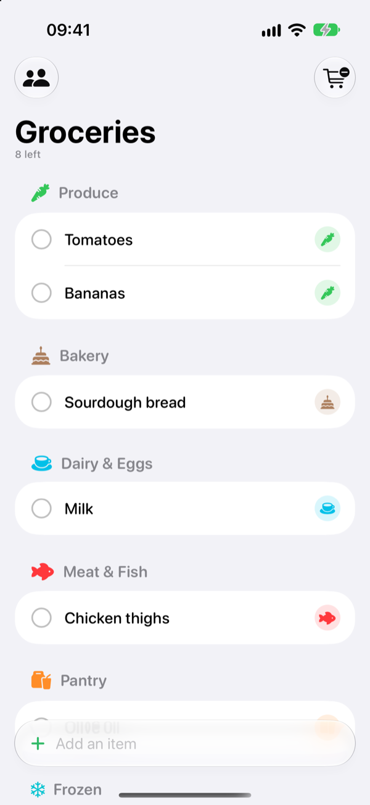
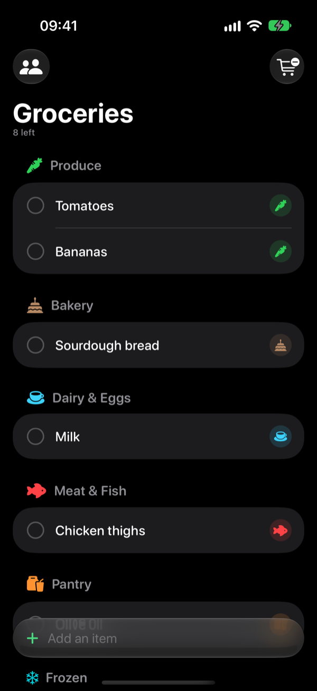
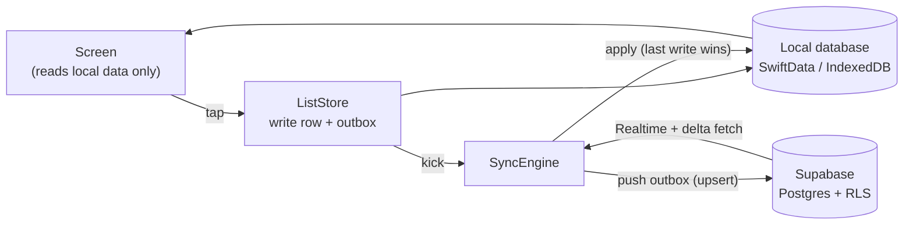

# 🛒 Shopping List

One shared shopping list for two people, live on both phones.

Either of you adds things at home the moment you notice you're out. At the market, either of you checks items off, and the other phone updates within a second. It opens instantly, works with no signal in the back of the supermarket, and catches up on its own when the connection comes back.

There are two ways to use it, both on the same backend:

- **iPhone app:** native SwiftUI for iOS 26, with Liquid Glass, haptics and springy motion.
- **Web app (PWA):** open a link and add it to your Home Screen. Nothing to install from a store, and it works on Android and desktop too.

Someone on the iPhone app and someone on the web app can share the same list.

<p align="center">
  
  &nbsp;&nbsp;
  
</p>

## Features

- **Instant capture.** Type "milk" and it lands in *Dairy & Eggs*. Categories are guessed from the name, in English and Portuguese, and you can change them.
- **Shop in store order.** Items are grouped by section, in roughly the order you walk the store. Checked items glide into an **In cart** section; **Clear** removes them when you're done.
- **Live between phones.** Your partner's changes show up within about a second, with a small "Ana got Milk" note and a brief highlight on the item.
- **Works offline.** Everything you do happens on the phone first and syncs later. Bad signal never blocks a tap, and if a change hasn't synced after a few seconds, a small marker shows next to it.
- **Share with a code and password.** Every list has a 6-character code. Choose a password, send the invite, and your partner taps **Join a list**.
- **No sign-up needed.** Start as a guest with just your name. Later you can save it as an email + password account to use it on another phone, keeping all your lists. The app never sends email.
- **Small touches:** a celebration when you check off the last item, drag to reorder (iPhone), dark mode, Dynamic Type, VoiceOver, and Reduce Motion support.

## How it works

The app is **local-first**. The screen only ever reads from a database on the device, and every change is written there first, so a tap never waits for the network. A sync engine reconciles that local copy with the server in the background.



1. **Write locally and queue it.** A tap updates the local row and adds an entry to an *outbox* in the same transaction. The screen updates on the same frame. Rapid taps on one item merge into a single request.
2. **Push in the background.** The sync engine sends the outbox to Supabase. If the network is down, it retries with backoff. If the server refuses a change, the item goes back to the server's version and a small notice appears. It never retries forever.
3. **Receive live, and catch up.** Each phone subscribes to its lists through Supabase Realtime. On launch and whenever the app comes back to the foreground, it also fetches everything changed since it last looked, so a missed live update is always recovered.
4. **Resolve conflicts simply.** For each item, the most recent change on the server wins. An edit you haven't synced yet is never overwritten by an older one.

Item IDs are generated on the device, so creating items offline needs no server round-trip. Deletes are soft (a `deleted_at` timestamp), so other devices learn about them through the same paths.

**Privacy and access.** Every table has Postgres Row Level Security: you can only read or write lists you're a member of. Joining a list goes through a server function that checks the code and a bcrypt-hashed password, and repeated wrong guesses are throttled.

The details are in [docs/sync.md](docs/sync.md) and [docs/data-model.md](docs/data-model.md).

## Tech stack

| | iPhone | Web |
|---|---|---|
| UI | SwiftUI, iOS 26 (Liquid Glass) | React + TypeScript, Vite |
| Local database | SwiftData | IndexedDB via Dexie |
| Backend client | `supabase-swift` | `supabase-js` |
| Offline | Outbox + `NWPathMonitor` | Outbox + service worker (Workbox) |
| Tests | Swift Testing, XCTest UI tests | Vitest |

**Backend:** [Supabase](https://supabase.com): Postgres with RLS, Realtime and Auth (guest and email + password users). The schema lives in SQL migrations, with pgTAP tests.

Both clients use the same design and the same names (`ListStore`, `SyncEngine`, `ConflictResolver`, …), so a change on one side is easy to mirror on the other.

## Repository layout

```
ShoppingList/        iPhone app (App, Features, Domain, Data/{Local,Sync,Remote}, DesignSystem)
ShoppingListTests/   unit tests, incl. SyncEngine against an in-memory FakeRemote
ShoppingListUITests/ UI smoke tests
web/                 web app (PWA): src/{features,domain,data,ui}, tests in src/test
supabase/            migrations, pgTAP tests, local config
docs/                product, architecture, sync, design system, ADRs
project.yml          XcodeGen spec (the .xcodeproj is generated, not committed)
```

## Getting started

You need macOS with Xcode 26, [Homebrew](https://brew.sh), Docker (for the local Supabase), and Node 22+ for the web app. The full guide is [docs/setup.md](docs/setup.md).

```sh
brew install xcodegen supabase/tap/supabase

# Backend (local)
supabase start                 # local Supabase in Docker; prints URL + publishable key
supabase db reset              # apply migrations + seed

# iPhone app
cp Config/Secrets.example.xcconfig Config/Secrets.xcconfig   # fill in URL + publishable key
xcodegen generate
open ShoppingList.xcodeproj    # run on a simulator or your phone

# Web app
cd web
cp .env.example .env.local     # fill in VITE_SUPABASE_URL + VITE_SUPABASE_KEY
npm install
npm run dev                    # http://localhost:5173
```

To try the iPhone app without any backend, run a seeded demo:

```sh
xcrun simctl launch booted com.gustavomartins.shoppinglist -uiTesting -seeded
```

### Deploying the web app

`npm run build` produces a static site in `web/dist`. Any HTTPS static host works. With Vercel, run `npx vercel --prod` from `web/`, after setting `VITE_SUPABASE_URL` and `VITE_SUPABASE_KEY` as project environment variables. To install it on a phone, open the URL and choose **Share → Add to Home Screen**. See [docs/setup.md](docs/setup.md#web-app-pwa).

Only the Supabase *publishable* key ever goes into an app. Never use the secret/service-role key.

## Tests

```sh
xcodebuild -scheme ShoppingList -destination 'platform=iOS Simulator,name=iPhone 17' test
cd web && npm test
supabase test db               # schema + RLS (pgTAP)
```

The tests focus where bugs would hurt most: sync correctness (outbox merging, edits made while a request is in flight, live partner changes, ignoring your own changes coming back, rejected writes) and who can access what. See [docs/testing.md](docs/testing.md).

## Docs

| | |
|---|---|
| [product.md](docs/product.md) | Vision, scope, milestones |
| [architecture.md](docs/architecture.md) | Layers, folders, data flow, both clients |
| [sync.md](docs/sync.md) | Offline, outbox, Realtime, conflicts |
| [data-model.md](docs/data-model.md) | Schema, RLS, functions |
| [design-system.md](docs/design-system.md) | Visuals, motion, haptics, accessibility |
| [performance.md](docs/performance.md) | Launch and scrolling budgets |
| [decisions/](docs/decisions/) | Architecture decision records: why things are the way they are |

## Status

Feature-complete for v1 on iPhone. The web app is live and in testing. Next up: running it day-to-day on both phones, a **Leave list** action, and, later, the App Store (Sign in with Apple, password reset). See the [milestones](docs/product.md#milestones).
